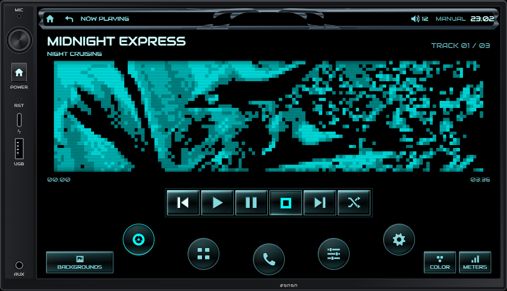
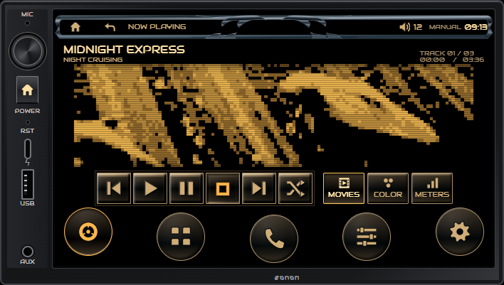

# DEH Modernized

## Android head-unit preview

Download the [Android preview APK](android/DEH-Modernized-Android-preview.apk?raw=1) and open it on an Android 8+ head unit. The optional Home-app setting can open it after boot if the unit permits it. File playback and dial support require testing on the target unit; FM, Bluetooth, camera and manufacturer DSP integrations are not connected. See [Android setup and limitations](android/README.md).

A complete, interactive Eonon X3 interface prototype with a Y2K cybercore skin: recessed theme-tinted media keys, round icon navigation and a carbon-alloy header, original Pioneer OEL animations and Amber/Cyan illumination.

## Run it

Download this repository using **Code → Download ZIP**, extract it, and open **index.html** in Chrome or Edge. The complete player and all assets are in this repository; no external ZIP or CDN is required. A local static server also works.

## Controls and appearance

- **Settings → Display → Color** switches Amber and Original cyan. Full-color animations retain their original colors.
- The **Movies, Color and Meters** buttons switch animation libraries directly. Tap the left or right side of the animation to browse within the selected library.
- **Shuffle** works independently for each library and advances moving clips when they finish. Color stills are available through manual browsing when Color shuffle is off; shuffle skips them.
- The compact layout keeps playback controls visible at the 720 × 405 preview size, with large round navigation buttons. There is no animation-pause control or song-seeking slider.
- All 83 original assets remain bundled at native resolution. Meters show their original stacked channels side by side; they are recorded, not live audio meters.
- **Display → Font** offers Audiowide, Orbitron and the supplied Accessories Urban font. The font, theme, dimming and animation preferences are saved.
- Source selection, volume, radio presets, 16-band EQ and audio settings are interactive demonstrations. Audio, radio and hardware connections are simulated.

## Source and checks

`source/` contains the editable interface, asset builders, pinned animation manifest and skin sources. `tools/build.py` rebuilds the root player from these files. Python 3 is sufficient for the UI build; regenerating the animation files additionally requires Pillow.

`docs/` contains frame/palette verification, browser checks, hardware evidence and desktop stress measurements. These desktop tests do not certify X3 performance. See [FEASIBILITY.md](FEASIBILITY.md).

**This is a browser prototype. No flashable firmware image is included.**

## Credits

- [Carozerra original animations and reference display effects](https://github.com/youxufkhan/carozerra)
- [X3 firmware investigation](https://github.com/prasys/eannon-x3-fw-reverse)
- Audiowide and Orbitron: Google Fonts, with their SIL Open Font License files in `assets/fonts/`.
- Accessories Urban font supplied by the project owner; original TTF retained in `assets/fonts/`.
